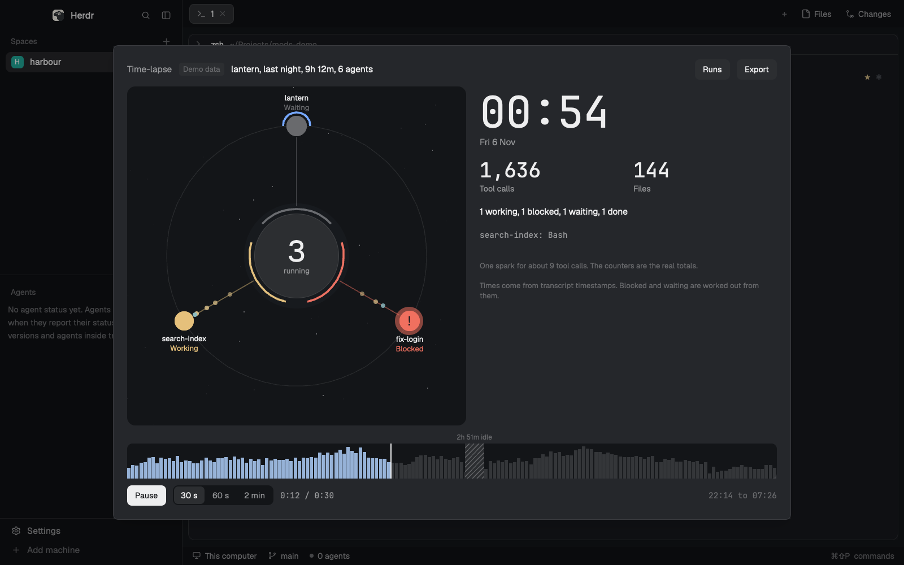

# Time-lapse

An overlay for Herdr that replays a run of Claude Code agents at high speed, so you can watch what happened overnight in 30 seconds. Agents appear on an orbit as they start, and it shrinks them to fit so none is hidden. Sparks fire on each tool call, and a clock and counters run along. `Sessions` lists past sessions with their length, agents and tool calls, so you can pick one.

A mod for the [Herdr](https://github.com/ogulcancelik/herdr) desktop app. Built for macOS, and run in a real Herdr 0.1.13 window there at the default zoom of 1.2.

Ask your agent to add it from [herdr.dev/mods](https://herdr.dev/gallery/?type=mods), or point it at this repo. It reads [the recipe](RECIPE.md) and every file first. By hand, copy `mods/timelapse` into `~/.config/herdr-app/mods` and merge `keys.json` into yours. `ctrl-shift-r` opens it.

It runs `python3` and reads your transcripts on this machine, for reading only, and makes no network calls. Times come from transcript timestamps, and blocked and waiting are worked out from them. Long idle gaps are compressed and marked.

Export writes one HTML file to `~/Downloads` that plays in any browser. It holds the folder name, agent names, tool names, times and file base names, and never prompts, tool results, file contents, commands or paths. A mod can't record video, so if you want one, play the file or the overlay and screen-record it.

`python3 tests/test_helper.py` and `node --test` run the checks.

MIT, see `LICENSE`.
