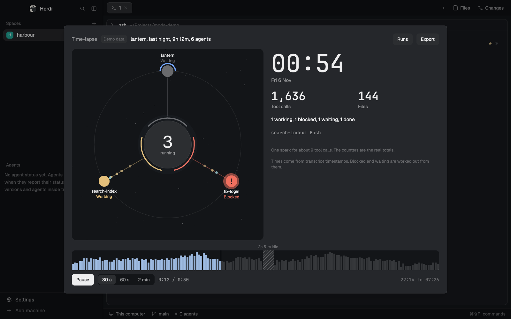

# Time-lapse

An overlay, opened by a key, that replays a run of Claude Code agents at high speed. You pick a session from a list that shows how big each one was, or it picks the latest big one, and watch it in 30 seconds, 60 seconds or 2 minutes: agents appear on an orbit as they start, sparks fire along spokes on each tool call, each node reads working, blocked, waiting or done, and a clock and counters run along. A timeline at the bottom shows the activity and can be dragged. Long idle gaps are compressed and marked. Export writes the same replay as one HTML file that plays in any browser.

## What you see

A 1000 by 700 overlay on `popover`, 20px padding, 10px between regions, base text 13px, `foreground`. Colours are theme names only. Top to bottom:

- **Header:** "Time-lapse" in 13px semibold `muted`. In demo mode, a "Demo data" tag, 11px `dim` on `raised`, radius 4. Then the run, 13px medium, such as "lantern, last night, 9h 12m, 6 agents". At the right, two 30px buttons on `raised`, radius 7, 12px medium: `Sessions` (`Back` while the list shows) and `Export`, dimmed to 45% except on the replay.
- **Map:** a square on a `canvas` well, radius 12, filling the height left over: `height - 158`, at least 280px, leaving 320px beside it. About 500px in the overlay.
  - The sky: 46 faint stars, in `popover` and `dim`, from a fixed seed.
  - The orbit, 58px in from the edge, or 20px once the map is dense: a 1px `border` circle.
  - The middle: a `raised` circle with a 1px `border` edge, a quarter of the map and at least 56px across. It holds the count of agents running, at 34% of its width in semibold, and "running" in 11px `muted`. When it stands for one session, that session's state word sits under it in 11px medium.
  - A 3px ring round the middle: one arc for each place on the orbit, pointing at it, in its state's colour, shown once that agent has started.
  - Spokes from the middle to each node, 1.5px, in the state's colour at 47% alpha.
  - Nodes: filled circles, 18 to 30px across, growing with the agent's calls so far. Past 12 places the map is dense: every node is shrunk to 70% of its share of the orbit, at least 4px, and drawn as one path for each state, with no labels, no `!` and no glow. A `done` node is its colour mixed 55% into `canvas`, as one solid colour, so the orbit doesn't show through it. A `blocked` node shows `!` in `background`, with a glow 12px wider on a 0.8s loop.
  - Subagents under a node: 3px arcs round it, one for each, in each one's state colour.
  - Labels, while the map isn't dense: outside each node, above it in the top part of the map and below it elsewhere, 118px wide: the name in 11px medium, and under it the state word in that state's colour.
  - Sparks: 5px dots, 7px when one stands for more than one call, in the colour of the tool's kind.
  - In a gap, a chip under the middle: "2h 51m with no tool calls", 12px medium on `canvas` with an `input` border, radius 6.
- **Side**, beside the map:
  - The clock, 64px mono semibold, such as "00:56", and the day, 13px `muted`, such as "Fri 6 Nov".
  - Two counters, 30px mono semibold, over 12px `muted` words: "Tool calls" and "Files".
  - The states, 13px, such as "1 working, 1 blocked, 1 waiting, 1 done".
  - The latest call, 12px mono `muted`, such as "search-index: Edit oil-view.ts".
  - An `i`, 20px round with a 1px `border` edge, 11px semibold `muted`, `hover` under the pointer. Resting on it for 150ms opens a 280px card anchored under it, on `popover` with a 1px `border` edge, radius 8, in 12px `foreground`: what a spark is worth, such as "One spark for about 9 tool calls. The counters are the real totals.", then "Times come from transcript timestamps. Blocked and waiting are worked out from them." It's a `HoverCard` from `gpui-base`, so moving onto the card keeps it open.
- **Timeline:** a 14px row of gap names in 10px `dim`, such as "2h 51m idle", then a 52px strip on `canvas`, radius 8. 160 bars in `input`, in `accent` up to the playhead, a 2px `foreground` playhead, and each gap as a `raised` band hatched in `dim`.
- **Controls:** a primary button (`solid`) reading `Play`, `Pause` or `Replay`, then "30 s", "60 s" and "2 min" as a switch on `canvas`, the chosen one on `raised`. The place in the clip, such as "0:12 / 0:30", in 12px mono `muted`. A note, 12px `muted`, or `blocked` if something failed. At the right the run's times, such as "22:14 to 07:26", in 12px mono `dim`.

Colours: working `working`, blocked `blocked`, waiting `idle`, done `done`. Sparks: writing `ansi3`, shell `accent`, reading `ansi6`, agents and skills `foreground`, other tools `muted`.

**The list** of sessions replaces everything under the header: a row of column names in 11px `dim` (Folder, Started, Length, Agents, Tool calls), then 40px rows, radius 8, the shown session on `selected`, `hover` under the pointer. Each has the folder in 13px medium, when it started in 12px `muted`, then in 12px mono `muted`, right aligned, the length, agents and tool calls, so a session's size can be judged before it's picked. It scrolls, up to 40 runs, with a 12px note under it if transcripts couldn't be read or old sessions were left out.

**The export note** replaces everything under the header: a 520px card on `canvas`, radius 12, titled "What this file holds" in 15px semibold. It lists the folder name and the real counts of agent names, tool names, timestamped events and file base names. Then "Never prompts, tool results, file contents, commands or paths.", a warning that file base names can say what you're working on, where it saves, and `Save` and `Cancel`.

While reading, a spinner in `accent` and "Reading transcripts: 40 of 90". A failure shows centred in 13px `blocked`. With nothing to show: "No runs with tool calls yet."

## How it behaves

- **Agent status:** this is a replay, so it comes from transcripts, not from Herdr's live status.
  - `working`: the agent has started, and nothing below applies.
  - `blocked`: an `AskUserQuestion` or `ExitPlanMode` call is open, or a quick tool (`Read`, `Write`, `Edit`, `MultiEdit`, `NotebookEdit`, `Glob`, `Grep`, `LS`) stayed open 30 seconds or more, which means someone was being asked.
  - `waiting`: a person's next prompt came 30 seconds or more after the last record with no tool open, or 10 minutes passed with no tool open and no record.
  - `done`: past the agent's last record in this run. Herdr's `idle` isn't used.
- **On open:** it reads the transcripts, groups them into runs, opens the latest big run and plays at 30 s. Big means 100 calls or more, and either more than one agent or at least an hour. With no big run it opens the latest.
- **What a run is:** sessions in the same folder that overlap, or that start within 60 seconds of another ending, as a `/clear` does. A session's subagents belong to it. A session silent for 6 hours or more is split there, so one resumed days later doesn't make a run of days. A checkout at `<repo>/.claude/worktrees/<name>` counts as `<repo>`. One at `~/.herdr/worktrees/<repo>/<name>` joins a folder called `<repo>` if there's exactly one.
- **Who sits where:** one session with subagents is the middle, and its subagents go on the orbit. Otherwise the sessions go on the orbit, in order of starting, and subagents are arcs round them. The first is at twelve o'clock. Each has its place from the start and appears there when it starts, fading in over 300ms of the clip. Every agent gets a place, however many there are. Past 12 the map goes dense, as above, so none is hidden.
- **Sparks:** a node's calls run in along its spoke. A lead session's calls run out to the place that started last. Each flight takes 700ms of the clip, up to 8 in the air, and a spark's place comes from the place in the clip alone, so a paused or dragged replay shows the same sparks.
- **Gaps:** 10 minutes or more with no tool call by anyone. Each takes 3% of the clip, less if there are many, with all of them held to 24%. The rest of the clip is shared by real time. The clock runs quickly through a gap, the chip shows on the map, and the timeline hatches it. Up to 6 gaps are named, longest first, leaving out names that would collide. A gap's agents keep their states.
- **Timeline:** press or drag anywhere on the strip to move the clip. It holds playback while you drag and picks up after, if it was playing. Letting go outside the overlay ends the drag when the pointer leaves it.
- **Play, Pause, Replay, 30 s, 60 s, 2 min:** as they read. A length changes how fast the rest plays, not the place in the clip. The clip stops at its end, and `Replay` starts it again.
- **Keys:** `space` plays and pauses, `left` and `right` move by 2% of the clip. Esc closes the overlay. The key again closes it too, because `mod.open` toggles.
- **Sessions:** the list pauses the replay. A press on a row opens that run and plays it. `Back` returns without playing.
- **Export:** a mod can't record video, so this is the honest stand-in: a page that plays the replay, which a person can screen-record. It pauses and shows the note. Nothing is written until `Save`. The note under the timeline then gives the path. `Cancel` writes nothing. A file of the same name is never replaced: `-2` is added. The file is made with exclusive create, so a file or link that turns up at that name is never written through.
- **The exported page:** the same map, side, timeline and controls, drawn on a canvas, with the same events and the same `timeline.js`, in the theme's colours. Press and drag, `space`, `left`, `right`, and the three lengths all work. It fits a phone's width, with the side under the map.
- **Motion:** while it plays, one `cx.timer.every(100)` moves the clip by the time that really passed, at most 400ms a tick, and renders. Sparks, the playhead and the fill glide between renders with `.transition`. Paused, nothing ticks. The middle glows on a 3.2s loop while playing with anyone running.

## Built from

- One mod, `mods/timelapse/`, with no layout. `mod.json`: `{ "place": "none", "title": "Time-lapse", "overlay": { "width": 1000, "height": 700 } }`. `keys.json`: `{ "global": { "ctrl-shift-r": "mod.open:timelapse" } }`.
- `props`: `{ "demo": true }` uses a made-up run. `mod.open` takes only a name, so demo mode opens another way: `herdr-app do tab.new '{"mod":"timelapse","props":{"demo":true}}'`, or `openOverlay({ mod: "timelapse", props: { demo: true }, width: 1000, height: 700 })` from another mod.
- `main.js`: the helper calls, the state and the one play timer.
- `timeline.js`: the replay, with no imports: `compress`, `fractionAt`, `timeAt`, `gapAt`, `indexCounts`, `thinForDrawing`, `activityBars`, `stateAt`, `placeAgents`, `prepareSteps`, `sparksAt`, `sceneAt` and the words. It's pasted whole into the exported page.
- `runs.js`: `groupRuns`, `latestBig`, `whenText`, `runLabel`.
- `logic.js`: helper arguments and replies, and the note's facts.
- `view.js`: the drawing. `replay.html`: the page, with `/*TIMELINE*/`, `/*RUN*/null`, `/*COLOURS*/null` and `{{TITLE}}` filled in by `helper.py`.
- `transcripts.py`: reads one transcript. `helper.py`: finds transcripts, keeps the cache, builds a run and writes the page. `sample.py`: the demo, from a fixed seed: lantern from 22:14 yesterday to 07:26 today, 6 agents, with nothing from 01:38 to 04:27, plus two smaller runs for the list. It goes through the same `build_run`.
- From `herdr`: `exec`, `appHome`, `home`, `props`, `settings`, `theme`. From `gpui-kit`: `View`, `div`, `PathBuilder`, and `window.paint_path`. From `gpui-base`: `h_flex`, `v_flex`. No Herdr commands are run.
- Program: `python3 -I -S -B <home>/mods/timelapse/helper.py`, with one of:
  - `scan --cache <home>/data/timelapse`, again until it stops saying `partial`.
  - `replay --cache <home>/data/timelapse --ids A,B --from MS --to MS`.
  - `export`, the same, with `--out ~/Downloads --colours <json>`.
  - `--demo` in demo mode. Each prints one line of JSON.
- An event is `[agent, ms from the run's start, tool, file, calls, new files]`, with `tool` and `file` as places in the reply's `tools` and `files` lists, and `file` -1 for none.
- No art. Everything is drawn.

## Watch out

- **Tell the person before adding it.** It runs `python3`. It reads Claude Code's transcripts in `~/.claude*/projects` and `$CLAUDE_CONFIG_DIR`, outside its own folder, for reading only. It also reads `agent-*.meta.json` beside subagent transcripts, for `agentType` only.
- **It makes no network calls.** Neither does the exported page, and a test checks it for network references.
- **What the export contains:** the folder name, agent names, tool names, timestamps, state changes and file base names. Never prompts, replies, tool results, file contents, commands, paths, or a subagent's description. Agent names are a folder's name or a subagent's `agentType`, with a number if repeated. File base names and the folder name can still say what someone is working on, which is why the note says to read them before posting. It's a sharing decision, so the note always comes first.
- **What it keeps:** `data/timelapse/` under Herdr's home holds `index.json`, with each transcript's path, size, times, folder name and a hash of its folder, and `bodies/`, with each one's tool names, times and file base names, and a hash of each file's path. No prompts or results. Delete the folder to clear it.
- **Timing comes from transcript timestamps.** They record when messages landed, not what anyone was doing. So states are worked out, and can be wrong: a permission prompt on a shell command reads as working, because a slow command and a waiting one look the same. A run still going reads `done` past its last record. Keep "worked out" wherever states are described.
- **A gap means no tool calls.** An agent can be busy in one, such as a long shell command or a long think. The chip says "with no tool calls", not "idle agents". The strip's short name says "idle".
- **Built for macOS, and tested this far.** On macOS it ran in a real Herdr 0.1.13 window at the default zoom of 1.2: `ctrl-shift-r` with no clash in Herdr's keys, opening, closing with the key and with Esc, reopening in under a second on 8,426 transcripts, the latest big run, a real run of three agents in a made-up repo with one blocked on a question and one waiting for its next prompt, Pause, dragging both ways, the three lengths, the list, Export, Cancel and Save, and demo mode with its gap. Not run there: `python3` off the PATH, because a stock Mac keeps one in `/usr/bin`. The exported page played in Chrome on Windows, with its clock moving and space pausing it, and asked for nothing over the network. It was built on Windows 11 with Herdr 0.1.12 and was first opened in a real window on macOS, as above. What ran on Windows: `herdr-app check` in a private home, with the loading, replay, playing, gap, blocked, end, list, export, problem, empty, demo and a worst-case state (80 agents, 6,000 events) each forced into `init`; the tests in `tests/`; `helper.py` under `python3 -I -S -B` on 3.12; the exported demo page in headless Chrome. The stock Mac `python3`, 3.9, runs the helper and its tests. `python3` must be on the PATH, which on a stock Mac means the command line tools.
- **Herdr stops a render or a task at about 55 ms,** and code that has just loaded runs far slower than it does warm. A stopped task takes its promise with it, and `catch` doesn't see it. So:
  - `render` sets `drawing` before it starts and clears it after, and a one-second timer asks again if it's still set.
  - Preparing a run is `prepareSteps`: small steps with `cx.sleep(1)` between them, each safe to run twice, so the same timer can start again from the step that was stopped.
  - The render is held to 110 elements at worst, tested. The six-agent demo averages 70, and 76 at most. 189 extra elements on another panel were enough to be stopped on 17 of 41 renders. So the sky, the bars, the gaps, the spokes and the arcs are paths kept on `view.paths`, and made again only when an agent appears, changes state or grows.
  - In `herdr-app check`, five renders in a row fitted inside one limit on just-loaded code, both for the demo and the worst case, and seven didn't: about 8 to 11 ms a render on a Ryzen 5 1600.
- **`check` enforces that limit too,** so timing many renders inside one will fail with "interrupted" for that reason alone.
- **No `setTimeout`, `clearTimeout` or `setInterval` in the mod.** They don't exist there, and a test greps for them. The time limit on `exec` is a race with `cx.sleep`. The exported page does use `requestAnimationFrame`, which is fine in a browser.
- **`exec` stops at 30 s, with 8 MiB of output and no stdin.** So a pass stops reading after 15 s and reports `partial`, each pass gets at least one file further, `helper.py` is given up on after 28 s, and a reply is held to 4 MiB. A first read of 793 MB in 568 files took 5.3 s, then 0.11 s once cached, with a 10 KB reply. A replay of 2,894 calls and 41 agents took 0.12 s, with a 74 KB reply.
- **Limits:** 6,000 events and 2,000 marks in a reply, 2,000 sessions in a scan, 40 runs in the list, 8 sparks in the air, about 16 sparks a second, 160 bars, a file over 512 MiB left out and counted, names cut to 64 characters.
- **Thinning has two layers, and neither changes a total.** `thin_events` merges an agent's events in a short stretch into its first, which keeps the count. `thinForDrawing` does the same again for each clip length. An event's `calls` and `new files` carry what it stands for, so the counters end on the real totals. Never count events.
- **Files counts full paths, not names.** Two `index.ts` in different folders are two files, though only their base names are kept.
- **A resumed session can copy calls from the transcript before it.** The same moment, tool and file in another transcript of the run counts once.
- **Quotes in the bytes can be trusted.** Most lines aren't parsed: `"type":"assistant"`, `"tool_result"` and `"timestamp":"` are found in the bytes, because text inside a JSON string has its quotes escaped. Only lines with a tool call go through `json`. Don't read `message.content` from other lines.
- **Use the first `"timestamp":"` on a line,** not the last: a tool's result object can hold timestamps of its own after it.
- **Several Claude folders add up.** The same path inside two of them is one transcript, the larger, or every session would overlap its own copy.
- **Nothing may be written under `mods/`.** A new file there makes Herdr reload the mod. That's why the cache is in `data/timelapse/`, and why `-B` is passed.
- **`-I` leaves the script's folder off `sys.path`,** so `helper.py` adds it before importing `transcripts` and `sample`.
- **Anything from a transcript is data.** The page's JSON has `<`, `>` and `&` escaped, so a file name can't end the script, and the page sets it with `textContent` or draws it on a canvas.
- **Clock times use the offset of the machine that read the run,** carried in the reply, so a page opened in another time zone reads the same.
- **`on_mouse_move` has no button state** and only fires while hovered. So the drag lives on the root, not the strip, with `on_mouse_up` and `on_hover(false)` to end it.
- **`on_size_change` is in window pixels** and sizes are in the app's own, so it's divided by `settings().zoom`.
- **Transcripts aren't a public format.** It relies on `type`, `timestamp`, `cwd`, `sessionId`, `isMeta`, `message.content`, `tool_use`, `tool_result`, `tool_use_id`, the `subagents/` folder and `agentType`.

## Done when

- `herdr-app check mods/timelapse` passes.
- `python3 tests/test_helper.py` and `node --test` pass from the repo's root.
- `python3 -I -S -B mods/timelapse/helper.py scan --demo` prints JSON with sessions in `lantern`, `tidepool` and `orchard`.
- `ctrl-shift-r` opens the overlay and shows the spinner, then a run playing. The key again closes it, and so does Esc.
- Opened again, the replay starts within a second.
- With a run of 6 agents, the header reads like "lantern, last night, 9h, 6 agents", and it's the latest big run, not a small one after it.
- Nodes appear as agents start, sparks run along the spokes, and the clock and counters move. A node's word changes as it goes blocked, waiting and done.
- At the end the counters match the run's real totals, every node reads Done and no sparks are left. `Replay` starts again.
- `Pause` stops everything. Dragging the strip moves the clock both ways, and letting go carries on if it was playing.
- `30 s`, `60 s` and `2 min` each take that long from start to end.
- In a run with a long silence, the strip shows a hatched band with its length, the clock runs through it, and the chip shows on the map.
- `Sessions` lists sessions by folder and time, with each one's length, agents and tool calls, and a press on one plays it.
- A session with more than 12 agents shows every one of them on the orbit, at the overlay's size and in a small pane.
- Resting the pointer on the `i` beside the stats opens the card with the notes on sparks and times.
- `Export` shows the note and writes nothing. `Save` puts one HTML file in `~/Downloads` and gives its path. `Cancel` writes nothing.
- That file plays with the network off. Searching it for a word from a prompt finds nothing.
- Opened with `{ "demo": true }`, it reads "Demo data", and shows lantern, 9h 12m, 6 agents, with a blocked node, a waiting node and a gap of about 2h 50m.
- After all that, `mods/timelapse/` has no new files, and `data/timelapse/index.json` exists.
- With `python3` off the PATH, the overlay says python3 couldn't start the helper.
